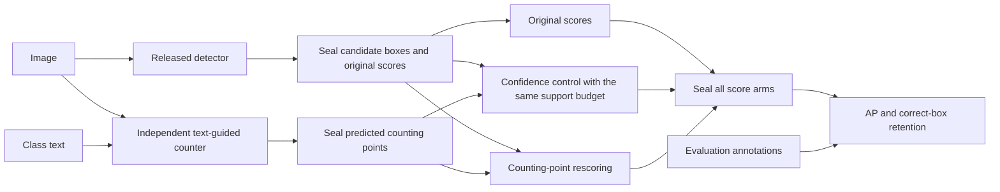

# Counting helps detection

Can independent counting points help a detector rank correct boxes higher?

This repository contains the experiment pipeline for reproducing released detectors, exporting a fixed pool of candidates, and comparing counting-point rescoring with a confidence control that supports the same number of boxes. It also measures how many originally correct boxes leave the top five.

## Reproduction results

AP is COCO box AP at IoU 0.50–0.95 on a 0–100 scale. Each score keeps its dataset, checkpoint and evaluation scope attached.

| Model | Evaluation | Reported AP | Reproduced AP | Verification |
| --- | --- | ---: | ---: | --- |
| GTR-X | COCO val2017, all 5,000 images, 80 classes | 59.4 | **59.38** | Full inference and stock evaluation complete on 17 November 2026 |
| D-FINE-X | COCO val2017, all 5,000 images, 80 classes | 59.3 | **59.31** | Archived full run, source and result checksums rechecked |
| D-FINE-X native Objects365 head | Fixed first 5,000 original validation images, 365 classes | — | **46.57** | Archived full run, fresh released-weight CPU entry verified, full rerun queued |
| Group DETR v2 released Paddle checkpoint | COCO val2017 | 63.3 | Pending | Strict CPU and native GPU forward verified, full COCO run active |
| TinyFormer-XL-PBM | COCO val2017 | 62.5 | Pending | Strict full-checkpoint CPU forward verified, full GPU run queued |
| DINOv3 + Plain-DETR | COCO val2017, shortest edge 2048 | 65.6 | Pending | Head verified on server, complete backbone transferring |
| RF-DETR-2XL | COCO val2017, 880 pixels | 60.1 | Deferred | User deferred execution pending the applicable platform license |

The GTR run retained all 300 native candidates per image, including one finite box with negative height. Its sealed native prediction stream has SHA-256 `88c80bbec96d39f6a2aeb597c2e6af2b235f82bea90ccf2a682ab05955cd060d`. The reported AP rounds to the author's value. Counting-point controls are pending explicit completion of missing counter queries.

[Full experiment scope and evidence](docs/results.md) · [model access and status](docs/model_access.md) · [Group DETR v2 setup](docs/group_detr_v2.md)

## Counting-guidance results

These D-FINE-X results come from the sealed historical experiment completed on 9 November 2026. Original, confidence and points use identical candidates within each dataset. The gain is relative to the matched confidence control.

| Evaluation | Original AP | Matched confidence AP | Counting-point AP | Gain |
| --- | ---: | ---: | ---: | ---: |
| COCO val2017, 5,000 images | 59.3070 | 59.4493 | **59.6737** | +0.2244 |
| Objects365, fixed 5,000 images, 365 classes | 46.5709 | 46.8030 | **47.4085** | +0.6055 |
| BMD-45, previous 1,084-image holdout, car/bus/truck | 52.8852 | 53.3647 | **53.9103** | +0.5455 |

Point guidance displaced 249 originally correct top-five candidates on COCO, 339 on Objects365 and 19 on BMD-45. The BMD-45 run recovered 38 previously unmatched targets and lost 16 previously matched targets. These diagnostics quantify the cost alongside the AP gain.

A separate BMD-45 adaptation study has a frozen fresh holdout. Detector training stopped at the user's priority change after 35 completed epochs, with a resumable checkpoint. Counter adaptation and fresh-holdout scores remain pending.

## Experiment flow



The counter uses the public Count Anything source pinned in `configs/counter.json`. The counter receives the image and class text. Its predicted points determine support through frozen one-to-one matching. The confidence control supports the same number of highest-confidence candidates per image and class. Both apply the same score transformation. Candidate coordinates, labels and identities remain fixed.

## Setup

Use Python 3.11 or newer. Install the lightweight evaluation package in an environment suited to the selected detector.

```bash
python -m pip install -e .
python -m unittest discover -s tests
python scripts/run_detector.py --list-models
```

Each released detector and the counter use their own pinned upstream source and dependencies. GTR requires its supported FLA runtime. Group DETR v2 uses an isolated Paddle environment. See [model setup](docs/model_access.md) and `configs/models.json` for exact revisions and weight checksums.

Place checkpoints under a local `pretrained/` directory and keep images under `data/`. Frozen image-only manifests and category prompts for both benchmarks are included under `configs/benchmarks/`. Preserve their order and original category IDs. [Input formats and evaluation rules](docs/protocol.md) describe the contract.

## Run an experiment

### 1. Export the detector candidates

The following example assumes the pinned GTR source is at `../detector-sources/GTR` and COCO images are at `data/coco/val2017`.

```bash
python scripts/run_detector.py \
  --model gtr-x \
  --source-dir ../detector-sources/GTR \
  --checkpoint pretrained/gtr_x_coco.pth \
  --images configs/benchmarks/coco_val2017/images.json \
  --image-root data/coco/val2017 \
  --device cuda --threads 1 --gpu-memory-fraction 0.12 \
  --output runs/gtr_coco/detector
```

The exporter checks strict state loading, image dimensions, the source revision and checkpoint hash. It writes per-image resumable chunks, a canonical `predictions.jsonl`, and a completion seal. Preserve the upstream model's native candidate count for reported AP.

### 2. Run the independent counter

Prepare `queries.json` with the image/category pairs required by the candidate stream. Existing independent counter caches can be supplied with repeated `--cache` arguments.

```bash
python scripts/run_counter.py \
  --source ../counter-sources/count-anything \
  --checkpoint pretrained/count_anything.pt \
  --images configs/benchmarks/coco_val2017/images.json \
  --vocabulary configs/benchmarks/coco_val2017/vocabulary.json \
  --queries data/coco/queries.json \
  --image-root data/coco/val2017 \
  --out runs/gtr_coco/counter
```

### 3. Produce the matched score arms

```bash
python scripts/rerank_predictions.py \
  --detector runs/gtr_coco/detector/predictions.jsonl \
  --counter runs/gtr_coco/counter/predictions.jsonl \
  --images configs/benchmarks/coco_val2017/images.json \
  --vocabulary configs/benchmarks/coco_val2017/vocabulary.json \
  --out runs/gtr_coco/arms
```

This writes `original.jsonl`, `confidence.jsonl`, `points.jsonl`, a per-query support-budget record and an input/output checksum seal. Missing counter queries produce an explicit coverage failure.

### 4. Score the sealed outputs

```bash
python scripts/evaluate_predictions.py \
  --gt data/coco/instances_val2017.json \
  --manifest configs/benchmarks/coco_val2017/images.json \
  --original runs/gtr_coco/arms/original.jsonl \
  --arm confidence=runs/gtr_coco/arms/confidence.jsonl \
  --arm points=runs/gtr_coco/arms/points.jsonl \
  --control-arm confidence \
  --metadata runs/gtr_coco/arms/PREDICTIONS_SEALED_PRE_GT.json \
  --output runs/gtr_coco/results.json
```

The evaluator reports pooled and class AP, displaced originally correct top-five candidate IDs, targets lost and targets recovered. Standard AP uses `maxDets=100`. The top-five diagnostic uses same-image, same-class greedy one-to-one matching at IoU ≥ 0.50. Full definitions appear in [the protocol](docs/protocol.md).

## Repository contents

```text
configs/       Pinned model and counter configuration
scripts/       Detector, counter, reranking and evaluation entry points
src/           Model adapters and fixed scoring/evaluation logic
tests/         Regression covering candidate identity and matched budget
docs/          Protocol, actual results, model access and Group DETR setup
```

## References and upstream licenses

- Siméoni et al., *DINOv3*, TMLR, May 2026. [Paper](https://arxiv.org/abs/2508.10104), [official code and approved-weight access](https://github.com/facebookresearch/dinov3).
- Hsieh et al., *TinyFormer*, arXiv, 24 May 2026. [Paper](https://arxiv.org/abs/2605.25046), [official code](https://github.com/mmpmmpmmpjosh/TinyFormer).
- Roboflow et al., *RF-DETR*, ICLR, April 2026. [Paper](https://arxiv.org/abs/2511.09554), [official code](https://github.com/roboflow/rf-detr), [platform model license](https://github.com/roboflow/rf-detr_plus/blob/main/LICENSE).
- Feng et al., *GTR*, arXiv, 22 September 2026. [Paper](https://arxiv.org/abs/2609.26590), [official code](https://github.com/Intellindust-AI-Lab/GTR).
- Peng et al., *D-FINE*, ICLR, April 2025. [Paper](https://arxiv.org/abs/2410.13842), [official code](https://github.com/Peterande/D-FINE).
- Chen et al., *Group DETR v2*, arXiv, November 2022. [Paper](https://arxiv.org/abs/2211.03594), [released Paddle implementation](https://github.com/PaddlePaddle/PaddleDetection/tree/release/2.9/configs/group_detr).
- Lei et al., *Count Anything*, arXiv, May 2026. [Paper](https://arxiv.org/abs/2605.30846), [official source](https://github.com/Mengqi-Lei/count-anything), [released weights](https://huggingface.co/MengqiLei/count-anything).
- ECDet / EdgeCrafter provides an additional recent-detector implementation check. [Official code](https://github.com/Intellindust-AI-Lab/EdgeCrafter), [paper](https://arxiv.org/abs/2603.18739).

Upstream code and model weights retain their respective licenses and access conditions. Download them from their authors. This repository contains experiment adapters and evaluation code.
