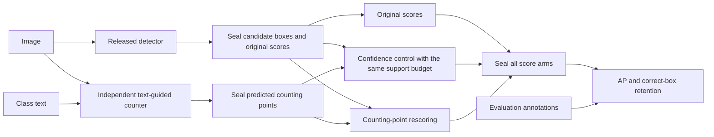

# Counting helps detection

Can independent counting points help a detector rank correct boxes higher?

This repository contains the experiment pipeline for reproducing released detectors, exporting a fixed pool of candidates, and comparing counting-point rescoring with a confidence control that supports the same number of boxes. It also measures how many originally correct boxes leave the top five.

## Reproduction results

AP is COCO box AP at IoU 0.50–0.95 on a 0–100 scale. Each score keeps its dataset, checkpoint and evaluation scope attached.

### COCO val2017

All completed rows use all 5,000 validation images, the original 80 categories, native released candidates and standard `maxDets=100` evaluation. This reproduction round completed on 17–18 November 2026.

| Detector | Published AP | Reproduced AP | Input | Execution |
| --- | ---: | ---: | --- | --- |
| DINOv3 + Plain-DETR | 65.4 | **65.38** | Short edge 1536, BF16 runtime | Full 5,000-image inference and evaluation complete |
| Group DETR v2, released Paddle checkpoint | 63.3 | **63.30** | Short edge 1184, max 2000 | Complete |
| TinyFormer-XL-PBM | 62.5 | **62.48** | 640 × 640 | Complete |
| RF-DETR-2XL | 60.1 | Deferred | 880 × 880 | Deferred by the user pending the applicable platform license |
| GTR-X | 59.4 | **59.38** | 640 × 640 | Complete |
| D-FINE-X | 59.3 | **59.31** | 640 × 640 | Fresh full run complete |

The five completed scores agree with their corresponding released values after rounding. DINO uses the author-reported 1536-pixel setting with reference AP 65.4. Its 2048-pixel setting has reference 65.6 and exceeded the available RTX 4090 memory on the widest validation image. The current run records BF16 storage/autocast and PIL bilinear preprocessing. The cited paper leaves inference dtype and initial image interpolation unspecified. Group DETR uses the released single-scale COCO validation reference. Its paper also describes other datasets and test-time settings.

### Native Objects365 heads

Both detectors use the same frozen first 5,000 images of the original validation panel, with original category IDs. All 365 categories enter evaluation, and 362 have non-crowd targets in this panel. These are fixed-subset reproduction scores.

| Detector | Reproduced AP | AP50 | AP75 | Execution |
| --- | ---: | ---: | ---: | --- |
| GTR-X native Objects365 head | **52.65** | 66.11 | 57.55 | Complete |
| D-FINE-X native Objects365 head | **46.57** | 58.53 | 50.83 | Fresh full run complete |

Full matched controls are complete for all five COCO detectors and both native Objects365 detectors. Each detector-specific counter cohort was sealed before scoring. The public pipeline checks complete counter coverage before generating the matched arms.

[Machine-readable results](results/summary_2026-11-18.json) · [Full experiment scope and evidence](docs/results.md) · [model access and status](docs/model_access.md) · [Group DETR v2 setup](docs/group_detr_v2.md) · [DINOv3 setup](docs/dinov3.md)

## Counting-guidance results this round

All COCO rows use the complete 5,000 validation images and 80 original categories. Original, confidence and points retain identical candidates. Confidence and points support the same number of boxes per image and class.

| Detector | Original AP | Matched confidence AP | Counting-point AP | Points − confidence | Points − original |
| --- | ---: | ---: | ---: | ---: | ---: |
| DINOv3 + Plain-DETR | **65.3753** | 65.2938 | 65.3578 | +0.0640 | −0.0175 |
| GTR-X | 59.3799 | 59.4140 | **59.6447** | +0.2307 | +0.2648 |
| Group DETR v2 | **63.2999** | 63.1847 | 63.2427 | +0.0580 | −0.0572 |
| TinyFormer-XL-PBM | 62.4842 | 62.5049 | **62.5684** | +0.0635 | +0.0843 |
| D-FINE-X | 59.3090 | 59.4506 | **59.6730** | +0.2225 | +0.3641 |

Both fresh native Objects365 comparisons use the previously frozen 5,000-image panel and original 365-category evaluation scope.

| Detector and data | Original AP | Matched confidence AP | Counting-point AP | Points − confidence | Points − original |
| --- | ---: | ---: | ---: | ---: | ---: |
| GTR-X native Objects365 | 52.6532 | 52.7184 | **53.1835** | +0.4651 | +0.5303 |
| D-FINE-X native Objects365 | 46.5741 | 46.8021 | **47.4097** | +0.6076 | +0.8355 |

GTR and TinyFormer improve over both baselines. DINO and Group improve over matched confidence, with their original detector AP remaining higher. Both have positive net top-five target gains, while their full AP change is negative. Both native Objects365 detectors improve over both baselines.

| Detector | Originally correct top-five boxes | Correct boxes displaced | Original targets lost | Previously unmatched targets recovered | Net matched-target change |
| --- | ---: | ---: | ---: | ---: | ---: |
| DINOv3 + Plain-DETR · COCO | 24,268 | 281 | 226 | 290 | +64 |
| GTR-X · COCO | 23,631 | 276 | 239 | 369 | +130 |
| Group DETR v2 · COCO | 24,330 | 305 | 275 | 294 | +19 |
| TinyFormer-XL-PBM · COCO | 24,007 | 252 | 222 | 277 | +55 |
| D-FINE-X · COCO | 23,580 | 251 | 219 | 350 | +131 |
| GTR-X · Objects365 fixed panel | 44,485 | 322 | 260 | 500 | +240 |
| D-FINE-X · Objects365 fixed panel | 43,609 | 338 | 261 | 570 | +309 |

Displacement follows candidate identity. Target loss and recovery follow one-to-one target matching. The reports retain both. A proposed source-trained residual correction will test whether the AP benefit and correct-box preservation can improve together.

### Historical matched controls

These D-FINE-X results come from the sealed historical experiment completed on 9 November 2026. Fresh D-FINE predictions have separate completed controls reported above. Original, confidence and points use identical candidates within each dataset. The gain is relative to the matched confidence control.

| Evaluation | Original AP | Matched confidence AP | Counting-point AP | Gain |
| --- | ---: | ---: | ---: | ---: |
| COCO val2017, 5,000 images | 59.3070 | 59.4493 | **59.6737** | +0.2244 |
| Objects365, fixed 5,000 images, 365 classes | 46.5709 | 46.8030 | **47.4085** | +0.6055 |
| BMD-45, previous 1,084-image holdout, car/bus/truck | 52.8852 | 53.3647 | **53.9103** | +0.5455 |

Point guidance displaced 249 originally correct top-five candidates on COCO, 339 on Objects365 and 19 on BMD-45. The BMD-45 run recovered 38 previously unmatched targets and lost 16 previously matched targets. These diagnostics quantify the cost alongside the AP gain.

The general-benchmark panels have been examined previously. Their documented zero overlap applies to a separate development panel. Training-image overlap with the released Count Anything checkpoint remains unverified. These results support fixed-cohort reproduction and transfer analysis.

A separate BMD-45 adaptation study has a frozen fresh holdout. Detector training stopped at the user's priority change after 35 completed epochs, with a resumable checkpoint. Counter adaptation and fresh-holdout scores remain pending.

## Experiment flow



The counter uses the public Count Anything source pinned in `configs/counter.json`. The counter receives the image and class text. Its predicted points determine support through frozen one-to-one matching. The confidence control supports the same number of highest-confidence candidates per image and class. Both apply the same score transformation. Candidate coordinates, labels and identities remain fixed.

## Setup

Use Python 3.11 or newer. Install the lightweight evaluation package in an environment suited to the selected detector.

```bash
python -m pip install -e .
python -m unittest discover -s tests
python scripts/run_detector.py --list-models
```

DINOv3 uses the dedicated `scripts/run_dino.py` entry with its two verified checkpoint files. Its [setup page](docs/dinov3.md) records the official 1536 setting, strict mmap/meta loading and the parity-verified feature-storage policy.

Each released detector and the counter use their own pinned upstream source and dependencies. GTR requires its supported FLA runtime. Group DETR v2 uses an isolated Paddle environment. See [model setup](docs/model_access.md) and `configs/models.json` for exact revisions and weight checksums.

Place checkpoints under a local `pretrained/` directory and keep images under `data/`. Frozen image-only manifests and category prompts for both benchmarks are included under `configs/benchmarks/`. Preserve their order and original category IDs. [Input formats and evaluation rules](docs/protocol.md) describe the contract.

## Run an experiment

### 1. Export the detector candidates

The following example assumes the pinned GTR source is at `../detector-sources/GTR` and COCO images are at `data/coco/val2017`.

```bash
python scripts/run_detector.py \
  --model gtr-x \
  --source-dir ../detector-sources/GTR \
  --checkpoint pretrained/gtr_x_coco.pth \
  --images configs/benchmarks/coco_val2017/images.json \
  --image-root data/coco/val2017 \
  --device cuda --threads 1 --gpu-memory-fraction 0.12 \
  --output runs/gtr_coco/detector
```

The exporter checks strict state loading, image dimensions, the source revision and checkpoint hash. It writes per-image resumable chunks, a canonical `predictions.jsonl`, and a completion seal. Preserve the upstream model's native candidate count for reported AP.

### 2. Run the independent counter

Prepare the required image/category queries from the sealed candidate stream. The query file contains image and category IDs. The independent counter receives the image and class text. Existing independent counter caches can be supplied with repeated `--cache` arguments.

```bash
python scripts/prepare_counter_queries.py \
  --detector runs/gtr_coco/detector/predictions.jsonl \
  --images configs/benchmarks/coco_val2017/images.json \
  --vocabulary configs/benchmarks/coco_val2017/vocabulary.json \
  --output runs/gtr_coco/queries.json

python scripts/run_counter.py \
  --source ../counter-sources/count-anything \
  --checkpoint pretrained/count_anything.pt \
  --images configs/benchmarks/coco_val2017/images.json \
  --vocabulary configs/benchmarks/coco_val2017/vocabulary.json \
  --queries runs/gtr_coco/queries.json \
  --image-root data/coco/val2017 \
  --out runs/gtr_coco/counter
```

### 3. Produce the matched score arms

```bash
python scripts/rerank_predictions.py \
  --detector runs/gtr_coco/detector/predictions.jsonl \
  --counter runs/gtr_coco/counter/predictions.jsonl \
  --images configs/benchmarks/coco_val2017/images.json \
  --vocabulary configs/benchmarks/coco_val2017/vocabulary.json \
  --out runs/gtr_coco/arms
```

This writes `original.jsonl`, `confidence.jsonl`, `points.jsonl`, a per-query support-budget record and an input/output checksum seal. Missing counter queries produce an explicit coverage failure.

### 4. Score the sealed outputs

```bash
python scripts/evaluate_predictions.py \
  --gt data/coco/instances_val2017.json \
  --manifest configs/benchmarks/coco_val2017/images.json \
  --original runs/gtr_coco/arms/original.jsonl \
  --arm confidence=runs/gtr_coco/arms/confidence.jsonl \
  --arm points=runs/gtr_coco/arms/points.jsonl \
  --control-arm confidence \
  --metadata runs/gtr_coco/arms/PREDICTIONS_SEALED_PRE_GT.json \
  --output runs/gtr_coco/results.json
```

For raw detector AP, the same evaluator accepts the sealed native stream directly.

```bash
python scripts/evaluate_predictions.py \
  --gt data/coco/instances_val2017.json \
  --manifest configs/benchmarks/coco_val2017/images.json \
  --original runs/gtr_coco/detector/predictions.jsonl \
  --output runs/gtr_coco/raw_results.json
```

The evaluator reports pooled and class AP, displaced originally correct top-five candidate IDs, targets lost and targets recovered. Standard AP uses `maxDets=100`. The top-five diagnostic uses same-image, same-class greedy one-to-one matching at IoU ≥ 0.50. Full definitions appear in [the protocol](docs/protocol.md).

For complete candidate pools such as DINO's 1,500 native rows per image, use `rerank_large_predictions.py` and `evaluate_large_predictions.py`. They index candidates on disk, run each complete stock-AP arm in a separate process and stream the top-five statistics. The scoring rule and evaluation definition are shared with the standard entries. [Complete DINO scoring commands](docs/dinov3.md#complete-pool-counting-controls)

## Repository contents

```text
configs/       Pinned model and counter configuration
scripts/       Detector, counter, reranking and evaluation entry points
src/           Model adapters and fixed scoring/evaluation logic
tests/         Regression covering candidate identity and matched budget
docs/          Protocol, actual results, model access and Group DETR setup
```

## References and upstream licenses

- Siméoni et al., *DINOv3*, TMLR, May 2026. [TMLR paper](https://openreview.net/forum?id=2NlGyqNjns), [preprint](https://arxiv.org/abs/2508.10104), [official code and approved-weight access](https://github.com/facebookresearch/dinov3).
- Hsieh et al., *TinyFormer*, arXiv, 24 May 2026. [Paper](https://arxiv.org/abs/2605.25046), [official code](https://github.com/mmpmmpmmpjosh/TinyFormer).
- Robinson et al., *RF-DETR*, ICLR, April 2026. [Paper](https://arxiv.org/abs/2511.09554), [official code](https://github.com/roboflow/rf-detr), [platform model license](https://github.com/roboflow/rf-detr_plus/blob/main/LICENSE).
- Feng et al., *GTR*, arXiv, 22 September 2026. [Paper](https://arxiv.org/abs/2609.26590), [official code](https://github.com/Intellindust-AI-Lab/GTR).
- Peng et al., *D-FINE*, ICLR, April 2025. [ICLR paper](https://proceedings.iclr.cc/paper_files/paper/2025/hash/6cf58a87e3097e7d1f9be3e8693a93de-Abstract-Conference.html), [preprint](https://arxiv.org/abs/2410.13842), [official code](https://github.com/Peterande/D-FINE).
- Chen et al., *Group DETR v2*, arXiv, November 2022. [Paper](https://arxiv.org/abs/2211.03594), [released Paddle implementation](https://github.com/PaddlePaddle/PaddleDetection/tree/release/2.9/configs/group_detr).
- Lei et al., *Count Anything*, arXiv, May 2026. [Paper](https://arxiv.org/abs/2605.30846), [official source](https://github.com/Mengqi-Lei/count-anything), [released weights](https://huggingface.co/MengqiLei/count-anything).
- ECDet / EdgeCrafter provides an additional recent-detector implementation check. [Official code](https://github.com/Intellindust-AI-Lab/EdgeCrafter), [paper](https://arxiv.org/abs/2603.18739).

Upstream code and model weights retain their respective licenses and access conditions. Download them from their authors. This repository contains experiment adapters and evaluation code.

The derived DINO feature-storage code is accompanied by the original agreement and source attributions. [DINOv3 agreement](third_party/notices/DINOv3-LICENSE.md), [source notices](third_party/notices/DINOv3-NOTICE.md)
